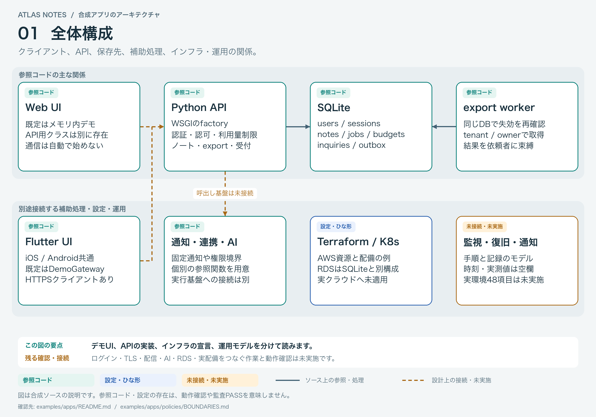
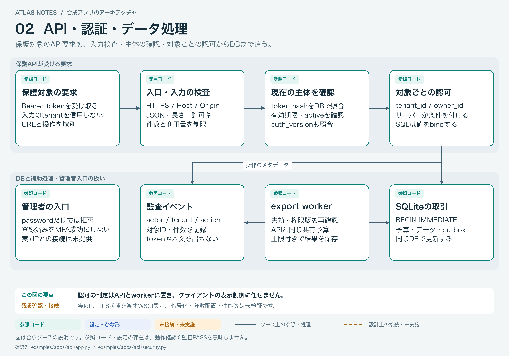
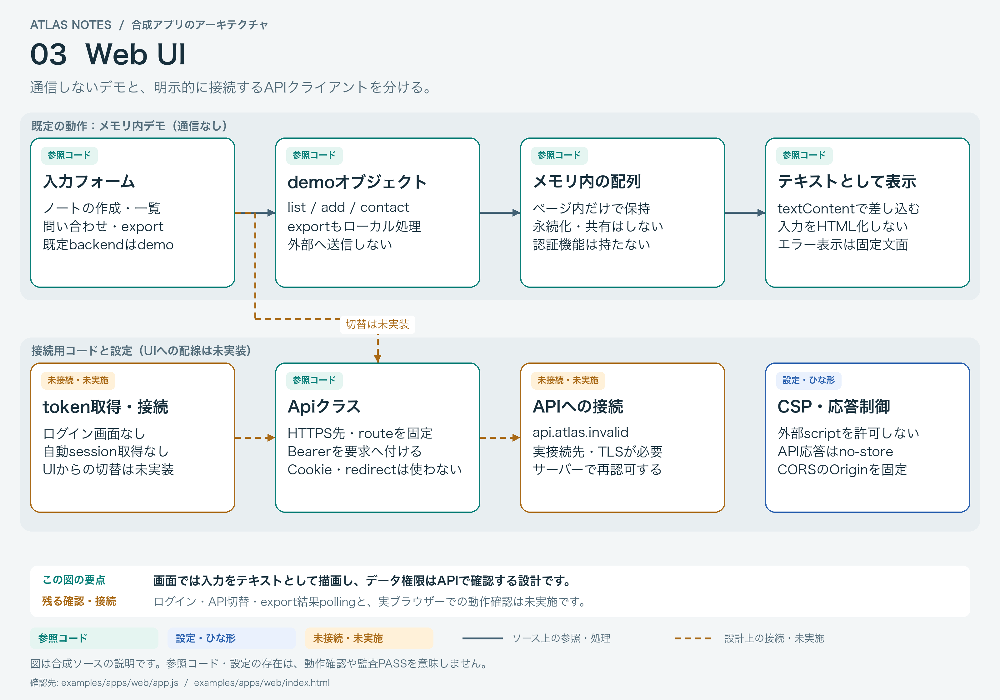
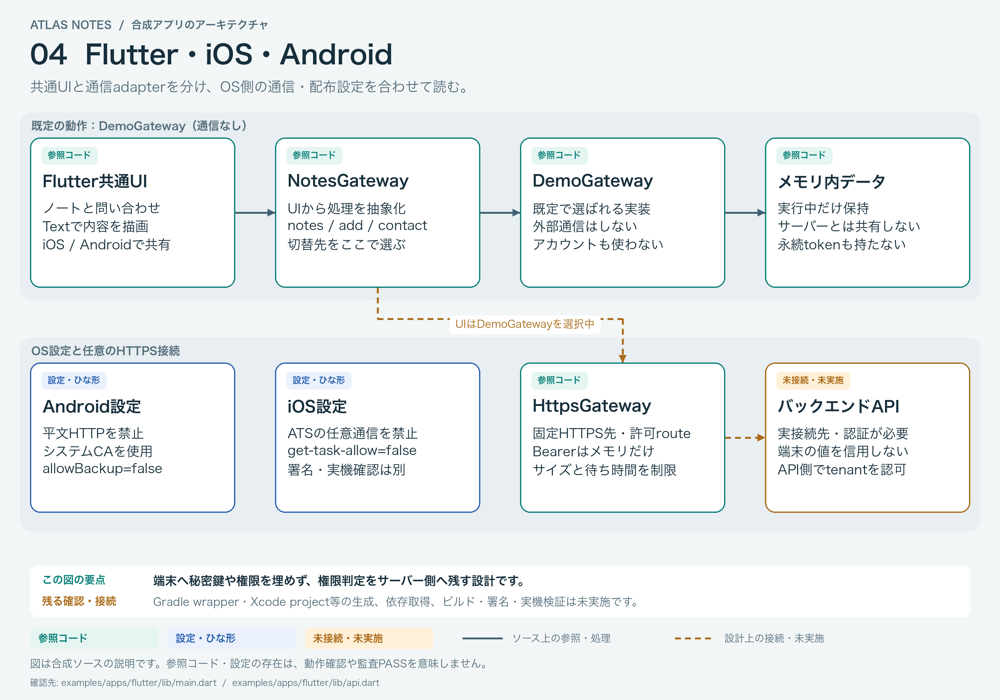
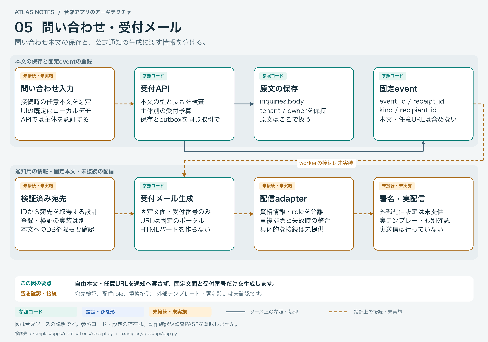
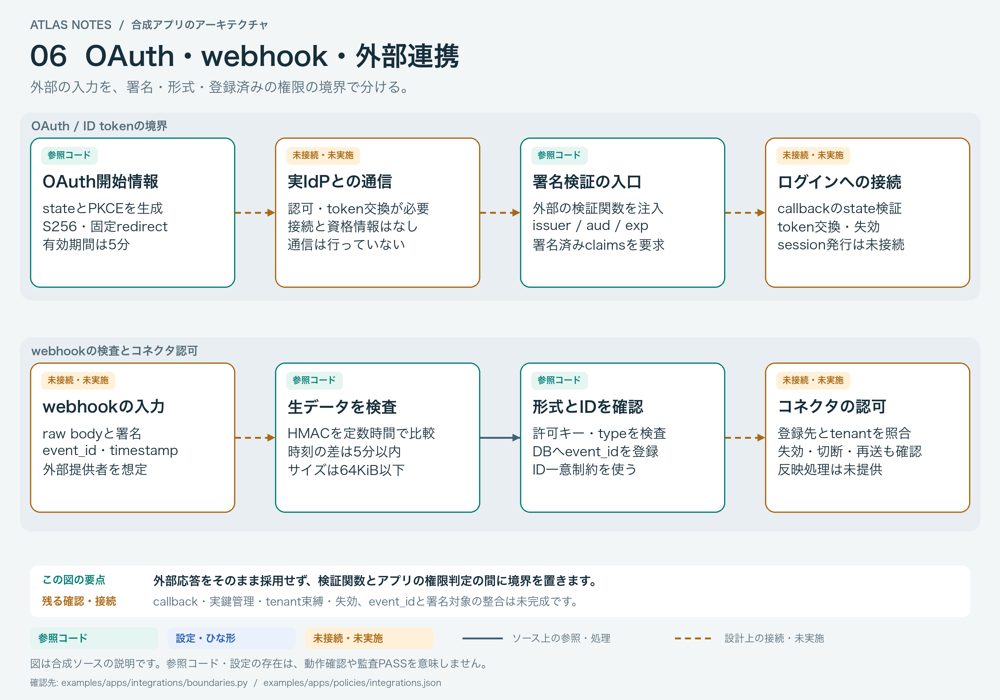
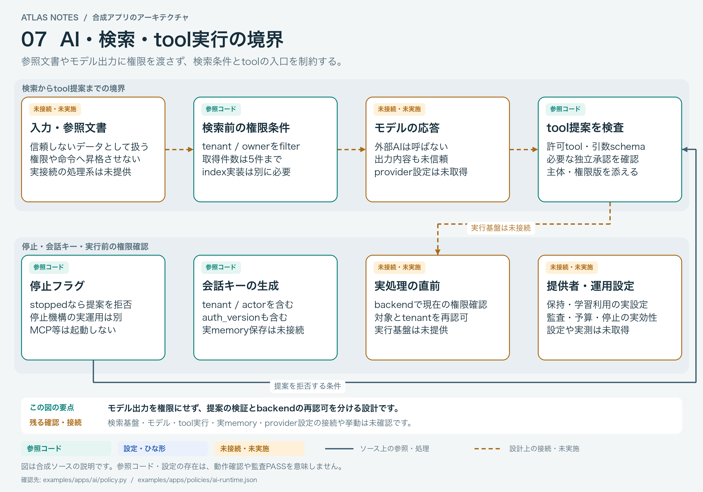
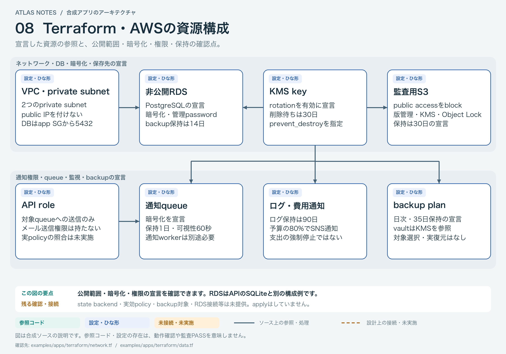
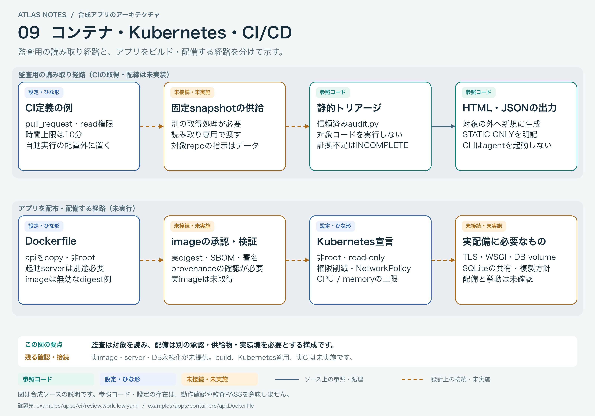
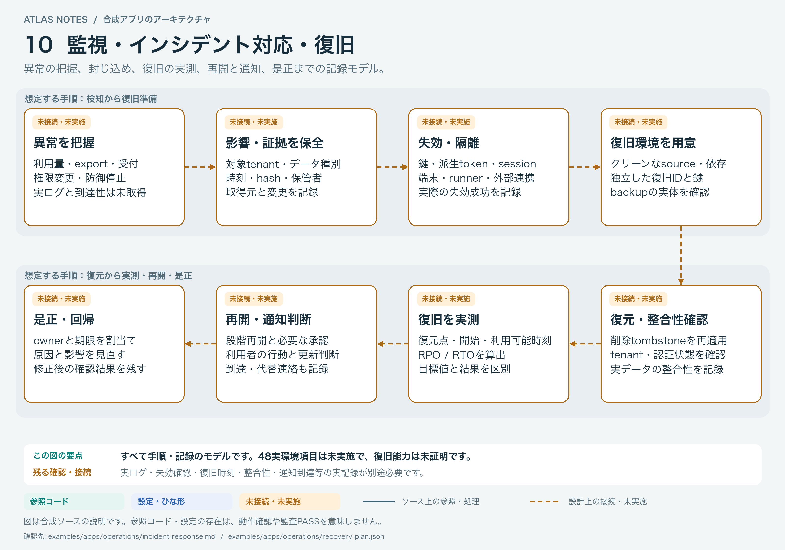

# Atlas Notes のアーキテクチャ図

[画像をまとめて読む](index.html)。PNGを選ぶと拡大でき、SVGも個別に開けます。全10枚、PNGは3200×2240pxです。

HTML内の表示画像は埋め込んであり、通信せずに読めます。元画像・SVG・ソースへのリンクは、このフォルダとリポジトリ内のファイルを参照します。

緑は参照コード、青は設定・ひな形、黄は未接続・未実施。実線はソース上の参照・処理、破線は設計上の接続です。各図は合成ソースの説明であり、配備済み・動作確認済み・監査PASSという意味ではありません。

## 01 全体構成

WebとFlutterは既定でそれぞれメモリ内デモを使います。API接続用コードは別にあり、APIの保存先はSQLiteです。TerraformのRDSや補助関数への配線は未提供です。



## 02 API・認証・データ処理

保護APIの入口・入力・現在の主体・対象ごとの認可を追います。APIとexport workerは同じSQLiteの予算・失効状態を確認します。管理者のパスワードログインは拒否し、実IdPへの接続は残しています。



## 03 Web UI

既定のdemoと、API接続用クラスは別です。入力はtextContentで表示します。ログイン、token取得、UIのAPI切替、export結果のpollingは未実装です。



## 04 Flutter・iOS・Android

共通UIはNotesGatewayを呼び、既定のDemoGatewayはメモリ内で処理します。HttpsGatewayと各OSの設定例を用意しています。SDK生成ホスト、署名資産、ビルド成果物は未提供です。



## 05 問い合わせ・受付メール

APIは原文の保存と、固定eventのoutbox登録を同じ取引で行います。通知生成は固定文面・受付番号・固定URLを使い、問い合わせ原文を受け取りません。宛先検証、通知workerの配線、配信role、重複排除、外部署名・テンプレート設定は別途必要です。



## 06 OAuth・webhook・外部連携

OAuth開始情報、署名検証関数の注入、webhookのHMAC・形式・ID登録を示します。実IdP、callback、tenantの登録先への束縛、event_idと署名対象の整合、切断・失効は未完成です。



## 07 AI・検索・tool実行の境界

検索前にtenant/owner条件を渡し、tool提案に許可リスト・schema・承認・停止を適用します。提案を実処理へつなぐbackendの再認可や、モデル・検索・実memoryへの接続は未提供です。



## 08 Terraform・AWSの資源構成

VPC、非公開RDS、KMS、S3、queue、IAM、ログ・予算通知、backupの宣言です。既定ではprovisioningを拒否します。実効policy、state backend、backup対象、APIのRDS接続は未提供で、init/validate/plan/applyは未実施です。



## 09 コンテナ・Kubernetes・CI/CD

信頼済みツールでsnapshotを読む監査と、供給物を承認して配備する経路を分けます。CI例は自動実行場所の外にあります。無効なimage digestの例、未提供のWSGIサーバー・DB volume等を残しており、build・実配備は未確認です。



## 10 監視・インシデント対応・復旧

検知、影響と証拠、失効・隔離、復旧準備、復元・整合性、RPO/RTO実測、再開・通知、是正の想定手順です。全て記録モデルで、実環境中心48項目は未実施のままです。



## ソースと再生成

各図の説明文と確認元のファイルは [index.html](index.html) に掲載しています。[diagrams.json](diagrams.json) に文言・配置・接続・対応ID、[assets.json](assets.json) に画像と確認元のhashを保存します。これらは文書生成用メタデータで、監査の証拠schemaとは別です。

再生成は、信頼済み開発workspaceで実行します。合成アプリのモジュールはimportしません。

```bash
python3 -B docs/architecture/render.py
```

描画時だけPillowと日本語フォントを使います。今回の描画環境はPillow 10.2.0、macOSのヒラギノ角ゴシックです。別環境では `--font` と `--bold-font` で利用可能な日本語フォントを指定します。フォントそのものは配布しません。監査CLIのPython 3.10+標準ライブラリという実行要件は変えていません。

[全220項目の教材対応表](../../examples/COVERAGE.md)と併せて参照してください。
